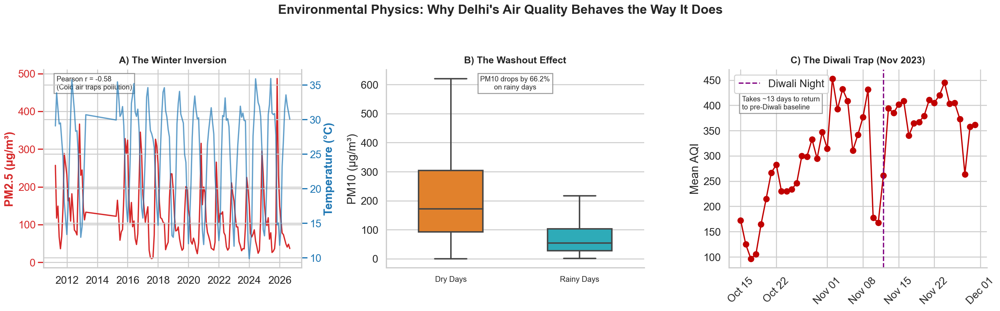
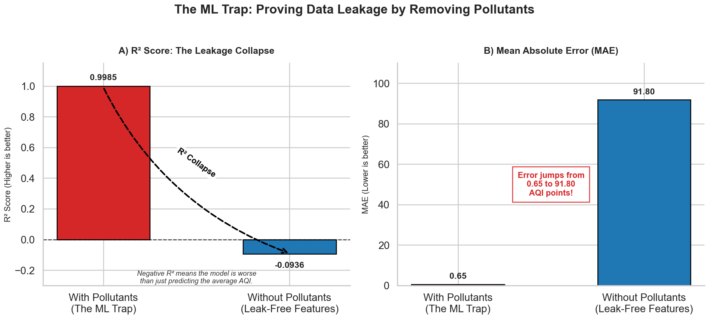
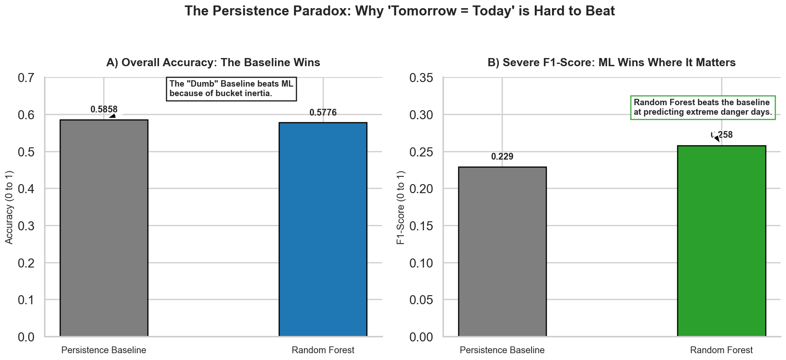
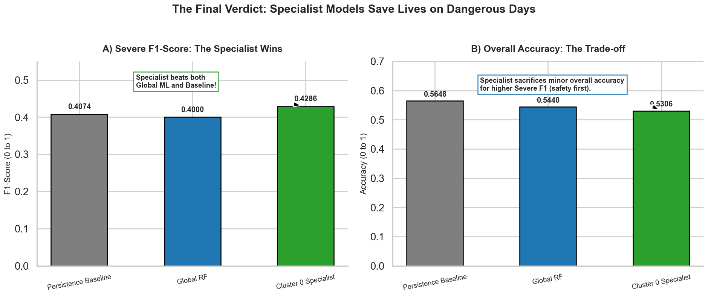
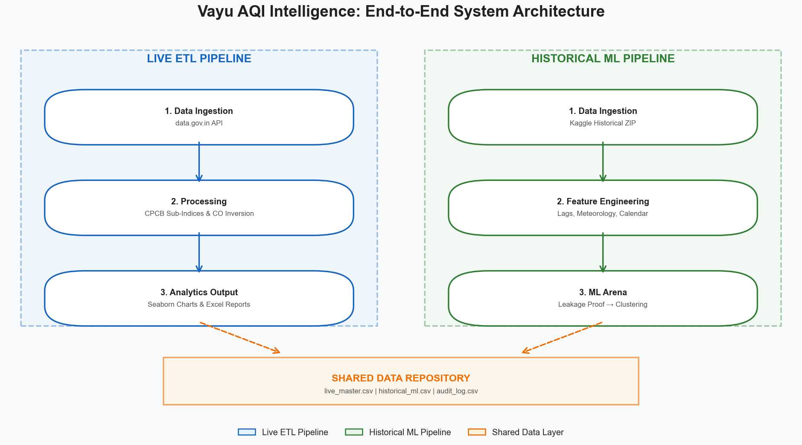
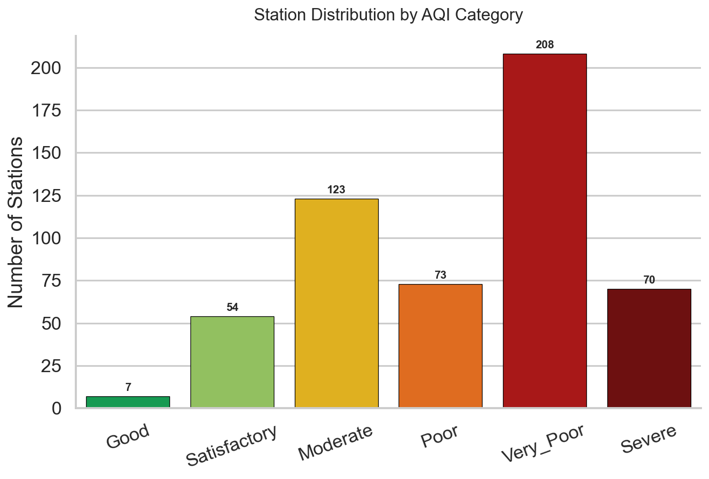

<div align="center">

# 🇮🇳 Vayu AQI Intelligence
### A Production-Grade Dual-Pipeline Platform for Air Quality Monitoring & ML Forecasting

[](https://www.python.org/)
[](https://scikit-learn.org/)
[](https://pandas.pydata.org/)
[](https://opensource.org/licenses/MIT)

</div>

> ###  **[START HERE: View the 16-Chapter Portfolio Presentation Notebook](./notebooks/05_portfolio_presentation.ipynb)**
> *A comprehensive, visual walkthrough of the entire project—from data ingestion and physics-based EDA to diagnosing machine learning data leakage and validating forecasting baselines.*

---

##  Executive Summary: The "99% Accuracy" Trap & Data Drift

Most AQI forecasting models train a Random Forest on today's pollutants and proudly report an **R² > 0.99**. 

**They are failing without realizing it.** The official Indian AQI is a deterministic mathematical formula calculated from those exact 7 pollutants. If you use today's pollutants to predict today's AQI, the model is not forecasting the future—it is simply reverse-engineering the government's math equation. 

**This project diagnoses that target leakage**, establishes a rigorous **Persistence Baseline** ("tomorrow = today"), and confronts the reality of **Data Drift**—proving that as Delhi's air gets cleaner, ML models must adapt or fail.

---

##  Visual Proof: The Analytical Journey

### 1. Environmental Physics (EDA)
*Cold air traps pollution, rain cleans it, and Diwali coincides with the winter inversion, keeping AQI elevated for weeks. We explored these phenomena using 17 years of hourly data.*


### 2. The ML Trap (Regression)
*When we removed the 7 primary pollutants, the model's R² collapsed from 0.9985 to -0.09, proving it was just reconstructing the CPCB formula rather than forecasting.*


### 3. The Persistence Paradox (Classification)
*A "dumb" baseline (predicting "tomorrow = today") beat our global ML models on overall accuracy (58.5% vs 57.7%) because AQI categories have massive inertia.*


### 4. The Final Verdict (Clustering)
*By clustering stations into High-Pollution and Low-Pollution regimes, our Specialist model matched the baseline on the critical metric: predicting dangerous "Severe" days (F1: 0.429 vs 0.407). Note: The test set contained very few Severe days, highlighting the challenge of rare-event forecasting.*


---

##  The 8 EDA Discoveries
*(Analysis of 17 years of hourly data across 95 Delhi monitoring stations)*

*   🌡️ **The Winter Inversion:** Temperature drops compress the boundary layer, trapping emissions (Pearson *r* = -0.58).
*   🌧️ **The Washout Effect:** Rain physically scrubs PM10 out of the air, though this effect is heavily confounded by the monsoon season.
*   🎆 **The Diwali Trap:** Because Diwali hits during the winter inversion, emissions are trapped, keeping AQI dangerously high for weeks.
*   🚗 **The Lockdown Effect:** April 2020 NO2 plummeted **55.7%**, proving how much traffic pollutes the air.
*   📅 **The Weekend Effect:** NO2 drops **5.3%** on weekends, confirming commuter traffic impact.
*   ☀️ **The Ozone Paradox:** PM2.5 peaks in Nov, while Ozone peaks in May. They are physically anti-phase.
*   ⚖️ **Co-Emission Ratio:** Winter is fine-particle (combustion) heavy; Summer is coarse-dust heavy.
*   🎯 **Station "Achilles Heel":** Generic city policies fail. Interventions must be hyper-localized based on a station's historical pollution profile.

---

##  The ML Arena (3 Acts)

| Act | Objective | Models Tested | The Result |
| :--- | :--- | :--- | :--- |
| **1. The Trap** | Predict today's AQI from today's pollutants. | 9 Regression Models | Random Forest achieved R² = 0.9985. **(Formula Reconstruction)** |
| **2. The Baseline** | Predict tomorrow's AQI category (leak-free). | 7 Classification Models | Persistence ("tomorrow = today") beat all global models on accuracy due to bucket inertia. |
| **3. The Solution** | Group stations by pollution regime. | K-Means + Random Forest | **Specialist Model** matched/beat the baseline on **Severe F1 (0.429 vs 0.407)** on a limited test set. |

---

##  System Architecture

The platform is built on a robust dual-pipeline architecture, separating real-time ETL monitoring from historical ML forecasting.



<details>
<summary><b>🔍 Click to expand the Dual-Pipeline Deep Dive</b></summary>
<br>

###  1. The Live API Pipeline (`src/`)
*   **Ingestion:** Fetches real-time CPCB data from `data.gov.in` using a firewall-bypassing User-Agent and pagination.
*   **Processing:** Computes official CPCB sub-indices using piecewise breakpoints. Includes rigorous CO-unit inversion logic.
*   **Analytics:** Generates 5 production Seaborn dashboards.
*   **Reporting:** Outputs a multi-sheet `executive_summary.xlsx` with audit logs.

###  2. The Historical ML Pipeline (`notebooks/`)
*   **Data:** Merges a massive nested Kaggle ZIP (2010–2026) into a single standardized CSV.
*   **Feature Engineering:** Implements Lag features (`aqi_lag_3d`, `aqi_lag_7d`), Diwali offsets, and meteorological interactions.
*   **Validation:** Uses **Temporal Splits** (80/20 by date) to prevent future data from leaking into the training set.
</details>

---

##  Gallery (Live Pipeline Outputs)

The real-time ETL pipeline automatically generates the following artifacts for stakeholders:

**1. Live Dashboard: AQI Category Distribution**


**2. Automated Executive Excel Report**
The ETL pipeline automatically generates a multi-sheet `executive_summary.xlsx` file using OpenPyXL. It features:
*   Data audits and missing value summaries.
*   Pollutant correlation matrices.
*   Top 10 most polluted cities and station-level statistics.

---

##  Detailed Project Structure

```text
vayu-aqi-intelligence/
├── .env.example           # API key template
├── requirements.txt       # Dependencies
├── data/                  # (Ignored in Git) Raw & Processed CSVs
├── src/
│   ├── ingestion/         # Live API fetching & Kaggle ZIP extraction
│   ├── processing/        # Cleaning, CPCB Sub-index math, Feature Eng
│   ├── analytics/         # Seaborn charts & Excel report generation
│   ├── ml_models/         # Evaluation metrics (R², MAE, F1)
│   └── run_live.py        # Live pipeline orchestrator
├── notebooks/             
│   ├── 01_eda_research_questions.ipynb
│   ├── 02_regression_models.ipynb
│   ├── 03_classification_arena.ipynb
│   ├── 04_unsupervised_clustering.ipynb
│   └── 05_portfolio_presentation.ipynb  <-- START HERE
└── assets/                # Generated charts and Excel reports
```

---

##  Quickstart

### 1. Clone & Install
```bash
git clone https://github.com/anandhusuresh04/vayu-aqi-intelligence.git
cd vayu-aqi-intelligence
pip install -r requirements.txt
```

### 2. Setup Environment
Rename `.env.example` to `.env` and add your API key from [data.gov.in](https://data.gov.in/).
```text
DATA_GOV_API_KEY=your_api_key_here
```

### 3. Run the Live Pipeline
Fetches live data, calculates CPCB sub-indices, generates 5 Seaborn charts, and writes an Excel summary.
```bash
python -m src.run_live
```

### 4. Run the ML Notebooks
```bash
jupyter notebook
```

---

## 🔮 Future Work: Scaling the Platform

As a Data Analyst, the next logical steps are to transition this from a local pipeline into an automated Business Intelligence (BI) product:

1.  **Interactive BI Dashboards:** Port the static Seaborn charts and Excel reports into an interactive **Power BI or Tableau** dashboard.
2.  **Automated Alerting System:** Connect the live pipeline to a Slack/Email webhook to alert health officials when AQI crosses "Severe" thresholds.
3.  **Data Quality & Monitoring (dbt):** Formalize the data cleaning steps into `dbt` models or SQL views in Snowflake/BigQuery for enterprise-grade data lineage.
4.  **Dynamic Retraining (MLOps):** Implement automated retraining every 6 months to combat the massive data drift (Severe days dropped from 14% to 1.4%).

---
*Built with an emphasis on statistical rigor, baseline defense, and data leakage prevention.*

---

<div align="center">
  <h3>🤝 Connect with Me</h3>
  <p>Let's connect! Feel free to reach out for collaborations, data discussions, or opportunities.</p>

  <a href="https://www.linkedin.com/in/anandhu-suresh-in/" target="_blank" style="margin-right: 10px;">
    
  </a>
  
  <a href="mailto:anandhu.suresh.dev@gmail.com" target="_blank" style="margin-right: 10px;">
    
  </a>
  
  <a href="https://github.com/anandhusuresh04" target="_blank" style="margin-right: 10px;">
    
  </a>
</div>