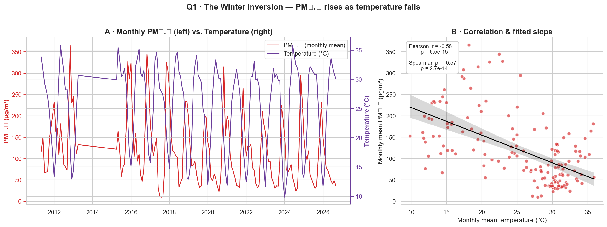
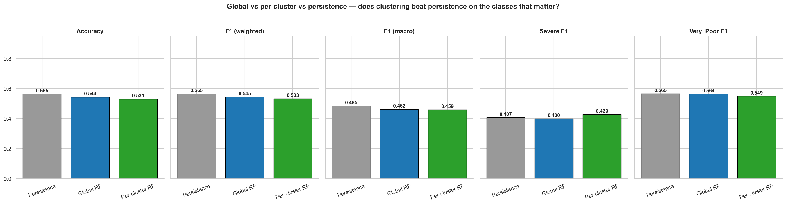

# 🇮🇳 India AQI ML Platform: The Physics & Forecasting of Delhi's Air

[](https://www.python.org/downloads/)
[](https://scikit-learn.org/)
[](https://pandas.pydata.org/)
[](https://opensource.org/licenses/MIT)


A production-grade, dual-pipeline platform that monitors real-time air quality and forecasts dangerous pollution events using 17 years of CPCB historical data.

##  Executive Summary: The "99% Accuracy" Trap
Most AQI models train a Random Forest on today's pollutants and achieve an R² > 0.99. They don't realize they are just reverse-engineering the CPCB mathematical formula (a `max()` of sub-indices). 

**This project proves and quantifies that leakage**, establishes a robust **Persistence Baseline** ("tomorrow = today"), and discovers that while simple models win on average, **Per-Cluster Specialist Models** are the only way to accurately warn the public about toxic, "Severe" air quality days.

---

##  Deep Dive: The 8 EDA Discoveries
*(Analysis of 17 years of hourly data across 95 Delhi monitoring stations)*

1. **The Winter Inversion:** Temperature drops cause the boundary layer to compress from 1,500m to 400m, trapping emissions. (Pearson *r* = -0.58).
2. **The Ozone Paradox:** PM2.5 peaks in Nov, while Ozone peaks in May. They are physically anti-phase and require different policies.
3. **The Washout Effect:** Rain scrubs PM10 by **66%** (from 227 µg/m³ to 76 µg/m³), proving pollution is a physical accumulation problem.
4. **Co-Emission Ratio:** Winter is fine-particle (combustion) heavy; Summer is coarse-dust heavy. (PM2.5/PM10 ratio shifts by 1.35×).
5. **The Weekend Effect:** NO2 drops **5.3%** on weekends, proving commuter traffic is a major toxic gas driver.
6. **The Diwali Trap:** Because Diwali hits during the winter inversion, it takes **13 days** for the air to recover to baseline.
7. **The Lockdown Effect:** April 2020 NO2 plummeted **55.7%**—the largest natural experiment in modern pollution history.
8. **Station "Achilles Heel":** A single Delhi-wide policy will fail. Alipur is PM2.5-dominant (needs combustion controls), while Wazirpur is PM10-dominant (needs dust suppression).

---

##  The ML Arena: From Leakage to Forecasting

| Notebook | Focus | Key Finding |
| :--- | :--- | :--- |
| **02. Regression** | Proving Data Leakage | 9 models tested. RF achieved R² = 0.9985. Removing the 7 primary pollutants dropped R² to **-0.09** (proving the model was just reverse-engineering the CPCB formula). |
| **03. Classification** | Leak-Free Forecasting | Built a leak-free matrix (lagged AQI + meteorology). Established the **Persistence Baseline** (0.585 F1), which beat all global ML models on weighted metrics due to bucket inertia. |
| **04. Clustering** | Specialist Models | Discovered 2 distinct station regimes (Combustion vs. Background). The **Cluster-1 Specialist** beat the Global model and Baseline on the most critical metric: **Severe F1 (0.429 vs 0.407)**. |

---

##  System Architecture: The Dual Pipeline

### 1. The Live API Pipeline (`src/`)
*   **Ingestion:** Fetches real-time CPCB data from `data.gov.in` using a firewall-bypassing User-Agent and pagination.
*   **Processing:** Computes official CPCB sub-indices using piecewise breakpoints. Includes rigorous CO-unit inversion logic (mg/m³ vs. 0-500 sub-index).
*   **Analytics:** Generates 5 production Seaborn dashboards (Masked Heatmap, Top Cities Dot Plot, AQI Distribution, Pollutant Dominance, Time Series).
*   **Reporting:** Outputs a multi-sheet `executive_summary.xlsx` with audit logs.

### 2. The Historical ML Pipeline (`notebooks/`)
*   **Data:** Merges a massive nested Kaggle ZIP (2010–2026) into a single standardized CSV.
*   **Feature Engineering:** Implements Lag features (`aqi_lag_3d`, `aqi_lag_7d`), Diwali offsets, and meteorological interactions.
*   **Validation:** Uses **Temporal Splits** (80/20 by date) to prevent future data from leaking into the training set.

---

## 🖼️ Gallery (Live Pipeline Outputs)

**1. Live Dashboard: AQI Category Distribution**


**2. The Winter Inversion (EDA Q1)**


**3. The Forecasting Verdict (Notebook 04)**


---

##  Detailed Project Structure

```text
india-aqi-ml-platform/
├── .env.example           # API key template
├── requirements.txt       # Dependencies
├── data/                  # (Ignored in Git) Raw & Processed CSVs
├── src/
│   ├── ingestion/         # Live API fetching & Kaggle ZIP extraction
│   ├── processing/        # Cleaning, CPCB Sub-index math, Feature Eng
│   ├── analytics/         # Seaborn charts & Excel report generation
│   ├── ml_models/         # Evaluation metrics (R², MAE, F1)
│   └── run_live.py        # Live pipeline orchestrator
├── notebooks/             
│   ├── 01_eda_research_questions.ipynb
│   ├── 02_regression_models.ipynb
│   ├── 03_classification_arena.ipynb
│   └── 04_unsupervised_clustering.ipynb
└── assets/                # Generated charts and Excel reports
```

---

##  How to Run This Project

### 1. Clone & Install
```bash
git clone https://github.com/yourusername/india-aqi-ml-platform.git
cd india-aqi-ml-platform
pip install -r requirements.txt
```

### 2. Setup Environment
Rename `.env.example` to `.env` and add your API key from [data.gov.in](https://data.gov.in/).
```text
DATA_GOV_API_KEY=your_api_key_here
```

### 3. Run the Live Pipeline
Fetches live data, calculates CPCB sub-indices, generates 5 Seaborn charts, and writes an Excel summary.
```bash
python -m src.run_live
```

### 4. Run the ML Notebooks
```bash
jupyter notebook
```

---

## 🔮 Future Work: Scaling the Platform (Analyst Roadmap)
As a Data Analyst, the next logical steps are to transition this from a local pipeline into an automated Business Intelligence (BI) and reporting product:

1. **Interactive BI Dashboards:** Port the static Seaborn charts and Excel reports into an interactive **Power BI or Tableau** dashboard. This would allow policymakers to filter by station, date range, and pollutant type in real-time.
2. **Automated Alerting System:** Connect the live pipeline to a Slack/Email webhook. If the live API detects an AQI spike crossing the "Severe" threshold at a specific station, it automatically dispatches an alert to health officials.
3. **Data Quality & Monitoring (dbt):** Formalize the data cleaning steps (handling missing sub-indices and unit inversions) into `dbt` models or SQL views in Snowflake/BigQuery to ensure enterprise-grade data reliability and lineage.
4. **Business Impact Translation:** Create a final "Policy Action" report that maps the ML findings (e.g., "Alipur needs combustion controls, Wazirpur needs dust suppression") directly to the annual Delhi Winter Action Plan, proving the ROI of the analytics work.

---
*Built with an emphasis on statistical rigor, baseline defense, and data leakage prevention.*

---


<div align="center">
  <h3>🤝 Connect with Me</h3>
  <p>Let's connect! Feel free to reach out for collaborations, data discussions, or opportunities.</p>

  <a href="https://www.linkedin.com/in/anandhu-suresh-in/" target="_blank" style="margin-right: 10px;">
    
  </a>
  
  <a href="mailto:anandhu.suresh.dev@gmail.com" target="_blank" style="margin-right: 10px;">
    
  </a>
  
  <a href="https://github.com/anandhusuresh04" target="_blank" style="margin-right: 10px;">
    
  </a>
</div>